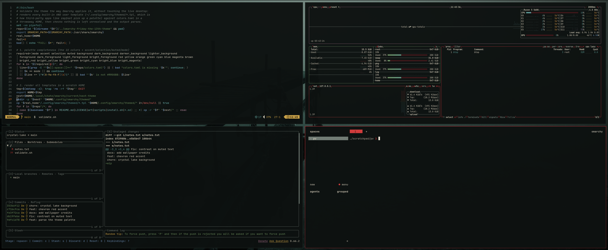

# Friday the 13th

A dark theme for [Omarchy](https://omarchy.org) inspired by *Friday the 13th*: Crystal Lake black-green water,
bone-white hockey-mask text, chevron red, and the campfire, lantern, forest and moonlight of a night at camp.



## Install

```bash
omarchy theme install https://github.com/gustavohariel/omarchy-friday-the-13th-theme
```

## Wallpapers

`01`–`07` are free-licence photos from Wikimedia Commons, regraded to night.
The regraded versions are shared under the same licence as their source.

| File | Source | Credit | Licence |
|---|---|---|---|
| `01-crystal-lake-dock.jpg`, `07-ki-ki-ki.jpg` | [Jetty in fog at Holländaröd](https://commons.wikimedia.org/wiki/File:Jetty_in_fog_at_Holl%C3%A4ndar%C3%B6d_1.jpg) | W.carter | CC0 |
| `02-the-woods.jpg` | [Las w porannej mgle](https://commons.wikimedia.org/wiki/File:Las_w_porannej_mgle,_gmina_Czernich%C3%B3w,_Rudnia%C5%84ski_Park_Krajobrazowy,_20240225_0810_6628.jpg) | Jakub Hałun | CC BY 4.0 |
| `03-lone-tree.jpg` | [Lonely tree at Fairy lake](https://commons.wikimedia.org/wiki/File:Lonely_tree_at_Fairy_lake.jpg) | Sergey Pesterev | CC BY-SA 4.0 |
| `04-oaks-in-fog.jpg` | [Dülmen, Leuste, Bäume im Nebel](https://commons.wikimedia.org/wiki/File:D%C3%BClmen,_Leuste,_B%C3%A4ume_im_Nebel_--_2020_--_5041.jpg) | Dietmar Rabich | CC BY-SA 4.0 |
| `05-island.jpg` | [Trustom Pond in the fog](https://commons.wikimedia.org/wiki/File:Trustom_Pond_in_the_fog_(12453p)2.jpg) | Rhododendrites | CC BY-SA 4.0 |
| `06-treeline.jpg` | [Forested hills in Lysekil in fog](https://commons.wikimedia.org/wiki/File:Forested_hills_in_Lysekil_in_fog_-_wide_-_B%26W.jpg) | W.carter | CC BY-SA 4.0 |

The grading script that produced them lives in [omarchy-friday-the-13th-wallpaper-tools](https://github.com/gustavohariel/omarchy-friday-the-13th-wallpaper-tools).
